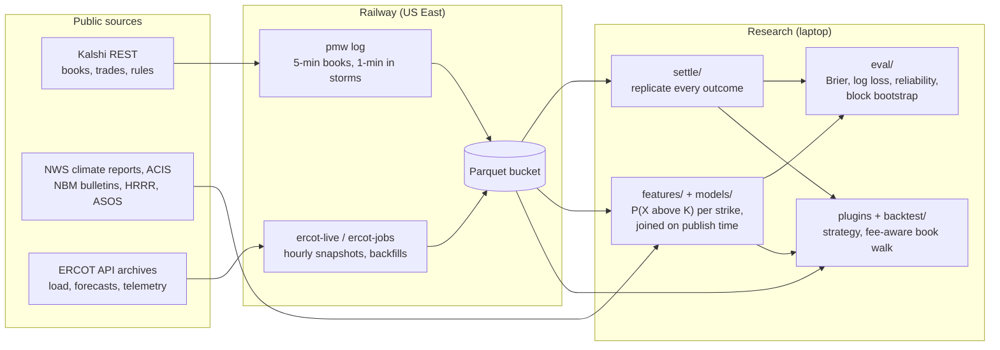
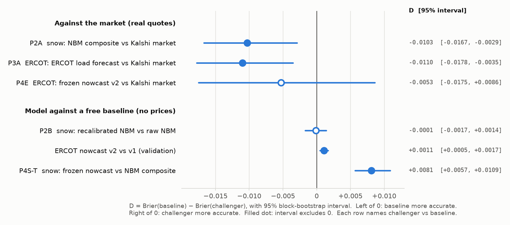
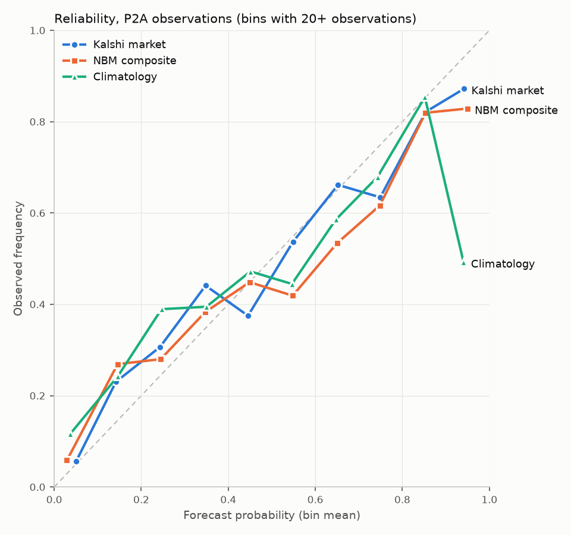

# pm-weather

**Is there a tradable edge in niche weather and energy prediction markets?**

`pmw` is a research pipeline for Kalshi's snowfall markets and ERCOT (Texas
grid) daily peak-demand markets. It logs full-depth order books, recomputes
every historical settlement from official data, turns public weather and load
data (NWS climate reports, the National Blend of Models, HRRR, ERCOT telemetry
and forecasts) into probabilities for each contract's strike, and compares
those probabilities with market prices using pre-registered tests, proper
scoring rules and block-bootstrap intervals. Trades are simulated against the
quoted side of the logged book after the exchange's fee.

Status (2026-11-17): the logger has run since 2026-11-14. Five pre-registered
experiments have run. In both direct tests of a free public forecast against
the market, the market was more accurate. A frozen ERCOT nowcast came close to
the market but did not beat it. A snow nowcast beat the free baseline on a
held-out winter and is now being tested on live order books through April
2027. No orders have been placed.

## Why these markets

Kalshi lists contracts such as "Will New York City get more than 4 inches of
snow in December?" or "Will ERCOT's peak demand tomorrow exceed 62,000 MW?" as
ladders of strikes, so the prices across a ladder are the market's implied
distribution for the underlying quantity. Public agencies publish calibrated
probabilistic guidance for the same quantities for free.

Hourly temperature markets are crowded with automated traders. Snowfall,
storm-window and grid-demand markets have the same structure and real volume
(last season's storm-window markets traded over 10 million contracts across six
events; a median stressed summer ERCOT day trades about 38,000 contracts), with
far fewer participants modelling them.

The first question is simple and falsifiable: **at the same timestamp, is the
market's probability better or worse than the free forecast?**

## Pipeline



Every feature joined to a market timestamp must have been published before it
(`issue_time < market_ts`); this is checked automatically in each experiment.
Weather data are split by season, never at random.

## Methodology

### Data sources

| Quantity | Source | Notes |
| - | - | - |
| Market prices and depth | Kalshi public REST | Bids only, best last; YES ask = 1 − best NO bid. Polled, not streamed (the WebSocket needs a signed handshake). |
| Daily snowfall (settlement) | NWS daily climate report via Iowa Environmental Mesonet; ACIS as a second source | Climate days run on local standard time all year. Intraday reports are excluded until the day is final. |
| Snowfall guidance | NBM station text bulletins (AWS archive) | 24-hour snowfall percentiles at the 01/07/13/19Z cycles; joined on availability, never on cycle time. |
| Short-range guidance | HRRR (AWS Zarr archive), NBM hourly | Point values per station; a run counts only after it is published. |
| ERCOT load (settlement) | First complete NP6-346-CD report | Hourly averages, from ERCOT's posting archive (2017 on). |
| ERCOT load forecast and telemetry | NP3-565-CD (7-day forecast), NP3-910-ER, public dashboard | Every posted version kept with its post time. |

### From data to fair probabilities

Every model outputs $P(X > K)$ for each strike $K$ on the contract's own
definition of $X$ (station, period and inequality are parsed from the rule
text, not assumed).

- **Snow, Monte Carlo composite.** At decision time $t$,
  $\text{Total} = \text{Observed} + \text{Forecast} + \text{Climate}$. Each NBM
  24-hour period is a piecewise-linear quantile function through its 10th to
  90th percentiles with a point mass at zero and an exponential upper tail.
  Periods are joined by a Gaussian copula (Spearman 0.5, 0 as a registered
  sensitivity). Days beyond the forecast come from whole-season block resampling
  of station climatology. "Strictly greater than $K$" on data reported to 0.1 in
  becomes a continuity correction at $K + 0.05$. (`src/pmw/models/nbm_composite.py`)
- **ERCOT baseline, empirical error ratios.** With $F$ the forecast daily peak and
  historical ratios $r_i = A_i / F_i$ from the same posting slot and a ±30-day
  seasonal window, $P(A > K) = \frac{1}{n}\sum_i \mathbf{1}[F r_i > K]$.
  (`src/pmw/eval/p3a_score.py`)
- **ERCOT nowcast, structural decomposition.** The settled peak is
  $A = \max(H, R)$: $H$ is the peak already seen in real-time telemetry and $R$
  the peak still to come. Only $R$ is modelled, as $y = \log(R / F_{\text{rem}})$,
  and $P(A > K) = 1 - P(H \le K)\,P(R \le K)$, with the telemetry-to-settlement
  gap in $H$ resampled from history. Candidate learners: NGBoost (Normal, with a
  variance recalibration on a held-out year) and LightGBM quantile regression at
  23 levels with a split-conformal shift per level, sorted to remove crossing.
  (`src/pmw/models/ercot_peak.py`, `ercot_peak_v2.py`)
- **Snow storm-window nowcast.** Combines observed snowfall so far, NBM and HRRR
  guidance for the rest of the window. Its features, model and parameters are
  kept private until its prospective test is scored (see the last section).
- **Time-ordered splits.** Train, calibrate, validate and test periods are
  consecutive; models are chosen on validation only; the test period is scored
  once.

### Comparing with market prices

- **Market probability.** Prices are scored at the bid-ask mid. Using the mid
  instead of an unknown belief inside a spread of width $s$ costs at most
  $s^2/12$ in Brier score (uniform belief within the spread), under 0.001 at the
  registered spread filter (spread ≤ 0.20).
- **Exchange fee.** Taker fee $= \lceil 0.07 \cdot C \cdot P(1-P) \rceil$ rounded
  up to $10^{-6}$, then the balance change floored to $10^{-4}$, in exact decimal
  arithmetic tested against the exchange's worked example. (`src/pmw/markets/fees.py`)
- **After-fee value against the quoted side.** Buying YES at level price $a$:
  $\mathbb{E} = p - a - \text{fee}(a)/C$; buying NO mirrors it on the YES bids.
  Every edge number in this project is measured this way, never against the mid.
- **Book walk with size limits.** A taker walks the opposite side's resting bids
  level by level while the after-fee value stays above a threshold, with caps per
  market and per event. The baseline rule (the one registered for P2A and P3A)
  is `pmw.strategy.NaiveTaker`; the walk is `pmw.backtest.taker.walk`.

### Evaluation

- **Proper scoring rules.** Brier score and log loss; the primary metric is the
  paired difference $D$ between two forecasts on the same (market, time) rows.
- **Calibration and resolution.** Reliability diagrams and the Murphy
  decomposition $\text{BS} = \text{REL} - \text{RES} + \text{UNC}$.
- **Block bootstrap.** 10,000 seeded resamples of whole calendar weeks for every
  interval on $D$ and on P&L, because one storm or heat wave moves many cities
  and strikes at once. Kish effective sample size
  $n_{\text{eff}} = (\sum_w n_w)^2 / \sum_w n_w^2$ shows that hundreds of
  contracts are about 20 independent weeks.
- **Signal versus luck.** The correlation between perceived edge (model minus
  price) and realized edge is reported next to every P&L number.
- **Decision rules designed by simulation.** Before any result was seen,
  synthetic worlds with known truth measured the false-positive rate and power
  of candidate go/no-go thresholds (`docs/findings/2026-11-14-prereg-design.md`).
- **Pre-registration.** Sample, metrics and decision rule are frozen before any
  price is joined to a forecast (`docs/preregistration.md`); each experiment runs
  once; deviations are logged with a reason.
- **Settlement replication gates everything.** A backtest is trusted only on
  markets whose outcome is recomputed from the official source.

## Results

**Settlement replication: 1,730 settled contracts recomputed from official data.**
Snow: 389 of 396 settled markets (monthly ladders in 11 cities back to 2021, and
storm-window markets) reproduce Kalshi's result and none contradict it; the other
7 belong to one Chicago event that Kalshi itself unwound. ERCOT: all 1,334
settled daily-peak markets reproduce.

**Every registered accuracy comparison.** Each row compares a challenger with a
baseline on the same rows; left of zero means the baseline was more accurate.



| Test | Rows | Challenger vs baseline | D | 95% interval | Verdict |
| - | -: | - | -: | - | - |
| P2A, snow, 2021 to 2026 | 16,268 | NBM composite vs market | −0.0103 | [−0.0167, −0.0029] | CONDITIONAL: market more accurate |
| P3A, ERCOT, Aug to Nov 2026 | 1,551 | ERCOT load forecast vs market | −0.0110 | [−0.0178, −0.0035] | CONDITIONAL: market more accurate |
| P4E, ERCOT, Aug to Nov 2026 | 1,534 | Frozen nowcast vs market | −0.0053 | [−0.0175, +0.0086] | CONDITIONAL: no difference shown |
| P2B, snow, winter 2025-26 | 133,665 cases | Recalibrated vs raw NBM | −0.0001 | [−0.0017, +0.0014] | No documented NBM weakness |
| P4S-T, snow, winter 2025-26 | 32,290 | Frozen nowcast vs NBM composite | +0.0081 | [+0.0057, +0.0109] | CONFIRMED: nowcast more accurate |

- **P2A (snow).** Kalshi's prices beat a probability built from NBM snowfall
  percentiles, observed snow and climatology (Brier 0.148 against 0.158). A
  naive taker trading NBM against the quote made +$508 on 33,653 contracts after
  fees, indistinguishable from zero.
  [Write-up](docs/findings/2026-11-15-p2a-result.md).
- **P3A (ERCOT).** The market beat ERCOT's own load forecast (Brier 0.056
  against 0.067), most clearly late in the day when it sees real-time load. A
  naive taker made +$261, but the more it disagreed with the market the worse it
  did (perceived-versus-realized correlation −0.33), so that P&L is not evidence
  of edge. [Write-up](docs/findings/2026-11-16-p3a-result.md).
- **ERCOT nowcast (validation, no prices).** v1 scored 20% better than the P3A
  baseline on held-out data, with 80% and 95% intervals covering 81.5% and 95.5%
  of outcomes; v2 adds weather inputs and is slightly better again.
  [v1](docs/findings/2026-11-16-phase4-ercot-v1.md), [v2](docs/findings/2026-11-16-phase4-ercot-v2.md).
- **P4E (ERCOT nowcast against the market).** The frozen model is better
  calibrated but the market is sharper; the interval spans zero. A naive taker
  using the model was profitable over 47 trades with a positive (+0.07)
  perceived-versus-realized correlation, which is suggestive, not conclusive. It
  is being tested prospectively on live books (P4-paper).
- **P2B and P4S-T (snow).** Recalibrating NBM from past winters does not help on
  a new winter, so NBM enters the snow model as is. The storm-window nowcast beat
  the NBM composite by 14% in Brier on a winter no model choice used.



**What this adds up to.** Free public guidance is already priced into both
markets. Any edge has to come from information or modelling the crowd does not
use, and has to be shown prospectively on data the model never saw, against
real bid and ask prices after fees. The samples are small and clustered (about
20 effective weeks of snow history, 12 calendar weeks of ERCOT), which is why
every interval above is clustered by week and the two open tests are
prospective:

| Prospective test | Sample | Scored |
| - | - | - |
| P4-paper: ERCOT nowcast on live books (also the market against ERCOT's forecast) | operating days 2026-11-18 to 2027-09-30 | once, on or after 2027-10-15 |
| P4S-paper: snow nowcast on live storm-window books | windows 2026-11-18 to 2027-04-30 | once, on or after 2027-05-15 |

## Quickstart

Python 3.12 via [uv](https://docs.astral.sh/uv/). Tests run offline on saved
real API responses; everything else uses public endpoints and needs no account.

```bash
git clone https://github.com/ru-u/pm-weather && cd pm-weather
make setup                         # core + research stack + pre-commit
make check                         # ruff, mypy, pytest (200 tests)

uv run pmw discover                # every open market matching configs/series.yaml
make log-test                      # three quick logger cycles into ./data
make settle-check SERIES=KXNYCSNOWM   # replicate a series' settlements (or SERIES=all)
uv run pmw ercot-settle-check      # replicate every ERCOT daily-peak market

make nbm nbs climo && make p2a     # experiment P2A end to end (downloads NBM bulletins)

uv run pmw plugins                 # strategies and probability models available
uv run pmw backtest obs.parquet    # paper taker backtest on logged books
```

`pmw backtest` reads one row per (market, decision time) with `ticker`,
`event_ticker`, `t`, `mid`, the book (`yes_px`, `yes_qty`, `no_px`, `no_qty`),
the model's inputs (by default a probability column `p_comp`) and, if known, the
outcome `y`. It runs the naive baseline unless a strategy is named;
`configs/params.example.yaml` shows the parameter file format (`--params` or
`PMW_PARAMS`). `make help` lists every target; `uv run pmw --help` every command.

## What is built

| Piece | Where | Notes |
| - | - | - |
| Kalshi public-data client | `src/pmw/markets/kalshi.py` | Paced, retrying, batched; live and historical endpoints. No credentials, no order code. |
| Fee model | `src/pmw/markets/fees.py` | Exact decimal arithmetic. |
| Market discovery and logger | `src/pmw/logger/` | Deployed on Railway. Regex discovery over series metadata, 5-minute books (1-minute for storm markets and volume spikes), append-only Parquet, gap detection, daily report. |
| Settlement replication | `src/pmw/settle/` | Snow (rule text parsed per market; trace, strict inequality and missing-day rules) and ERCOT (first complete report). |
| Weather data | `src/pmw/weather/` | NWS climate reports (finals versus intraday), ACIS, ASOS, NBM bulletins, HRRR Zarr points. |
| ERCOT data | `src/pmw/energy/` | API client, archive backfill from 2017, live snapshots; runs only from a US cloud region. |
| Models | `src/pmw/models/` | Snow Monte Carlo composite; ERCOT baseline, NGBoost and LightGBM-conformal nowcasts. |
| Experiments | `src/pmw/eval/` | P2A, P2B, P3A: scoring, block bootstrap, Murphy decomposition, taker simulation. |
| Plugin interface and backtest | `src/pmw/plugins.py`, `strategy.py`, `backtest/` | `Strategy` and `ProbabilityModel` protocols, entry-point discovery, naive taker baseline, fee-aware book walk. |
| Time handling | `src/pmw/utils/timeutil.py` | Climate days on local standard time; ERCOT operating days in Central time with DST flags. |

About 9,700 lines of source and 200 tests.

## Standards

- No lookahead: every input joined to a price was published before it, checked
  automatically.
- Walk-forward by season; the test period is touched once.
- Three baselines in every comparison: climatology, the public forecast, the
  market.
- Uncertainty from block bootstrap clustered by week, never from treating
  correlated strikes as independent bets.
- Edge measured against the quoted bid or ask after fees, at the size the book
  could have filled.
- Experiments pre-registered and run once; deviations logged; negative results
  written up.

## Roadmap

| Phase | Question | Status |
| - | - | - |
| 0 | Scaffold, environment, conventions | done |
| 1 | Live market logging | running since 2026-11-14 |
| 2 | Do snow prices beat NBM guidance? | done: no, the market is more accurate |
| 3 | Do ERCOT prices beat ERCOT's own forecast? | done: no, the market is more accurate |
| 4 | Snowfall and load nowcasts against the market | models frozen; prospective tests running to 2027 |
| 5 | Paper trading, then small live with hard limits | only on explicit approval |

## What is public and what is not

This repository holds the full research pipeline: data collection, settlement
replication, baselines, methodology and every result above. Live execution,
the tuned models and their parameters, and the Phase 4 experiment texts are
kept in a separate private package that plugs into `pmw` through the
`pmw.strategies` and `pmw.models` entry points. The pre-registered texts are
committed here by sha256 in [`docs/commitments.md`](docs/commitments.md) and
will be published after each test is scored, so they can be checked against
what was registered.

## Documents

- [`docs/preregistration.md`](docs/preregistration.md): hypotheses and decision rules
- [`docs/commitments.md`](docs/commitments.md): hashes of the private texts and frozen models
- [`docs/findings/`](docs/findings/): every result, including the design analysis behind the rules
- [`docs/settlement_rules.md`](docs/settlement_rules.md): rule text and interpretation per series
- [`docs/data_sources.md`](docs/data_sources.md): every source, with quirks
- [`docs/decisions.md`](docs/decisions.md): dated log of design decisions
- [`docs/deploy.md`](docs/deploy.md): hosting

This is research code. It places no orders and is not financial advice.
