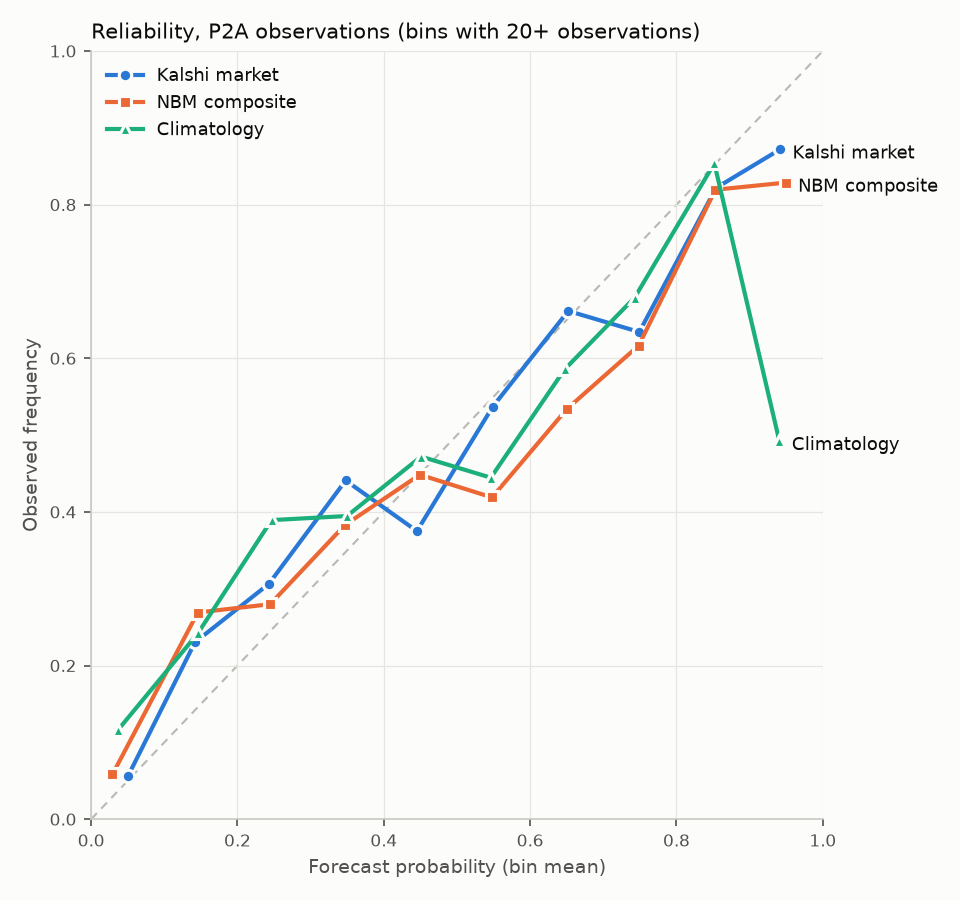

# 2026-11-15: P2A result. The Kalshi snow market beat the free NBM forecast

Experiment P2A, pre-registered in `docs/preregistration.md` (frozen 2026-11-14,
implementation clarifications 2026-11-15). Run once, 2026-11-15 21:04 UTC, with
`make p2a`. No deviations from the registration. Full tables:
[`p2a_result_tables.md`](p2a_result_tables.md).

## Verdict

**CONDITIONAL under the registered rule.** On accuracy alone the result points
the other way from the hope: the market's probabilities were *more* accurate
than a composite built from free NBM guidance, and the difference is
statistically clear. It is not a NO GO only because the simulated trading P&L
was not clearly negative; it was not clearly positive either, and it carried no
sign of real edge.

## What was compared

At four fixed times a day, for every settled monthly and storm-window snowfall
market in 11 cities from November 2021 to March 2026 (382 markets, 66 events,
Chicago December 2025 excluded as registered), three probabilities for "total
snowfall above the strike":

- **Market:** mid of the last hourly bid and ask before the decision time, two-sided,
  spread at most 0.20.
- **NBM composite:** snow already observed + NBM 24-hour snowfall percentiles from
  the latest cycle public before the decision time + station climatology for
  days beyond NBM's ~9-day reach, combined by Monte Carlo.
- **Climatology:** observed + climatology only.

16,268 observations in 84 calendar-week blocks.

## Results

| | D = Brier(market) - Brier(NBM) | 95% CI |
| - | -: | - |
| **Primary** | **-0.0103** | **[-0.0167, -0.0029]** |
| Spread <= 0.10 | -0.0096 | [-0.0157, -0.0023] |
| Spread <= 0.30 | -0.0104 | [-0.0171, -0.0026] |
| NBM with independent days | -0.0122 | [-0.0189, -0.0045] |

Negative D means the market was more accurate. Every registered variant agrees
in sign and excludes zero.

| Forecast | Brier | Log loss |
| - | -: | -: |
| Kalshi market | **0.148** | **0.456** |
| NBM composite | 0.158 | 0.491 |
| Climatology | 0.194 | 0.607 |

Both the market and NBM are far better than climatology, so NBM carries real
information. The market carries more.

**Naive taker strategy** (trade when NBM disagrees with the quote by more than
10 points after fees, 10% of the hour's volume, capped): 925 trades, 33,653
contracts, **+$508 after $412 of fees**, 95% interval **[-$2,366, +$3,581]**,
positive in 63% of bootstrap resamples (GO needed 90%). The correlation between
perceived edge and realized edge was **0.04**: the size of the disagreement told
us almost nothing about the outcome. Storm-window trades lost $342.

## Reading the strata (registered, secondary)

- **The market wins even where NBM should matter most.** Within 3 days of the
  window's end, D = -0.034 [-0.063, -0.003] (465 observations, 43 events). So
  this is not just the market beating climatology on the long tail of a month.
- **Most observations are far from resolution.** 84% are more than 9 days before
  the window ends, where the composite is mostly observed snow plus
  climatology. There, D = -0.009 [-0.016, -0.000].
- **Era.** In the NBM V4.0 period (New York only, 2021-23, 7 events) NBM was
  more accurate: D = +0.040 [+0.003, +0.087]. Last winter (V4.3, 49 events,
  11 cities) the market was: D = -0.013 [-0.020, -0.006]. Version is
  confounded with era, city count and volume, so this cannot be pinned on NBM.
  It is consistent with the market having become more efficient as it grew.
- **Storm windows** (6 events, 4 weeks, point estimate only as registered):
  D = -0.054. No inference possible.
- **Calibration.** The NBM composite is overconfident in the middle and at the
  top: forecasts of 0.55 and 0.65 verified at 0.42 and 0.53, and 0.95 at 0.83.
  Both NBM and the market under-forecast rare outcomes (0.15 verified at about
  0.23 to 0.27).

## What this means

1. **Free NBM guidance is priced in.** Kalshi's snow markets already reflect it
   and more. There is no easy edge in trading NBM against the quote.
2. **Per the registered rule (CONDITIONAL):** snow modeling (Phase 4) starts only
   if experiment P2B finds a specific, sizeable NBM weakness, and any model must
   then beat NBM out of sample before it is compared with the market again. The
   calibration pattern above (NBM overconfident between 0.5 and 0.7 and at the
   top) is a lead for P2B, not a finding.
3. **Effort moves toward ERCOT (Phase 3)** and the prospective storm-window test
   (P2A-S) on this winter's logged order books. Storm windows carried 42% of last
   winter's volume, and history cannot test them.

## Limits of this result

- Hourly candle quotes, not order books: the mid can be stale or one contract deep.
- Observed snow counts as public 8 hours after each climate day ends, which is
  later than a trader watching live observations would know it. This handicaps
  the NBM composite slightly, by design (conservative against a false GO).
- The composite is one registered construction; a better use of the same NBM
  data could do better. That is exactly the question P2B and Phase 4 address.
- Both daily-data sources serve the latest version of each value, not the
  initial report Kalshi settles on.
- About 20 effective weekly blocks: an edge of a point or two in Brier score
  either way would not be detected.
