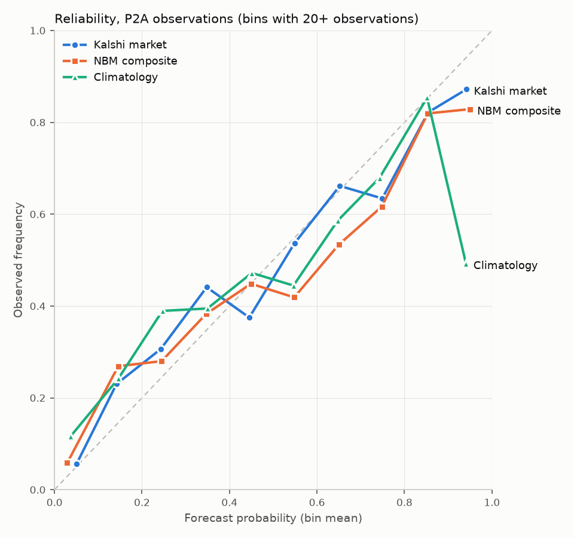

**Verdict under the registered rule: CONDITIONAL**

## Primary metric

D = Brier(market) - Brier(NBM composite); positive means NBM is more accurate.

| | Observations | Weekly blocks | D | 95% CI (block bootstrap) |
| - | -: | -: | -: | - |
| Primary (spread <= 0.20) | 16,268 | 84 | -0.0103 | [-0.0167, -0.0029] |
| Sensitivity: spread <= 0.1 | 15,450 | 83 | -0.0096 | [-0.0157, -0.0023] |
| Sensitivity: spread <= 0.3 | 16,640 | 85 | -0.0104 | [-0.0171, -0.0026] |
| Sensitivity: NBM with independent days | 16,268 | 84 | -0.0122 | [-0.0189, -0.0045] |
| Reference: climatology instead of NBM | 16,268 | 84 | -0.0458 | [-0.0855, -0.0140] |

## Scores

Base rate (share of observations that resolved Yes): 0.321

| Forecast | Brier | Log loss | Reliability | Resolution | Uncertainty |
| - | -: | -: | -: | -: | -: |
| Kalshi market | 0.1481 | 0.4558 | 0.0036 | 0.0725 | 0.2181 |
| NBM composite | 0.1584 | 0.4910 | 0.0058 | 0.0649 | 0.2181 |
| Climatology | 0.1939 | 0.6073 | 0.0159 | 0.0397 | 0.2181 |

Reliability table (bins of forecast probability):

| Bin | Kalshi market n / mean p / freq | NBM composite n / mean p / freq | Climatology n / mean p / freq |
| - | - | - | - |
| 0.0-0.1 | 5836 / 0.05 / 0.06 | 5743 / 0.03 / 0.06 | 5727 / 0.04 / 0.12 |
| 0.1-0.2 | 2727 / 0.14 / 0.23 | 2052 / 0.15 / 0.27 | 2518 / 0.15 / 0.24 |
| 0.2-0.3 | 1613 / 0.24 / 0.31 | 1833 / 0.24 / 0.28 | 1852 / 0.25 / 0.39 |
| 0.3-0.4 | 1066 / 0.35 / 0.44 | 1303 / 0.35 / 0.38 | 1495 / 0.35 / 0.39 |
| 0.4-0.5 | 952 / 0.45 / 0.38 | 979 / 0.45 / 0.45 | 1106 / 0.45 / 0.47 |
| 0.5-0.6 | 725 / 0.55 / 0.54 | 838 / 0.55 / 0.42 | 929 / 0.55 / 0.44 |
| 0.6-0.7 | 653 / 0.65 / 0.66 | 768 / 0.65 / 0.53 | 707 / 0.65 / 0.59 |
| 0.7-0.8 | 730 / 0.75 / 0.63 | 665 / 0.75 / 0.62 | 542 / 0.74 / 0.68 |
| 0.8-0.9 | 920 / 0.85 / 0.82 | 908 / 0.85 / 0.82 | 677 / 0.85 / 0.85 |
| 0.9-1.0 | 1046 / 0.94 / 0.87 | 1179 / 0.95 / 0.83 | 715 / 0.94 / 0.49 |

## Strata (point estimates of D; intervals where 5+ weekly blocks)

| Stratum | Value | Observations | Weeks | Events | D | 95% CI |
| - | - | -: | -: | -: | -: | - |
| kind | monthly | 15,952 | 84 | 59 | -0.0094 | [-0.0158, -0.0021] |
| kind | storm | 316 | 4 | 6 | -0.0536 | n/a |
| lead_band | 3 to 9 d | 2,117 | 31 | 59 | -0.0148 | [-0.0247, -0.0006] |
| lead_band | < 3 d | 465 | 15 | 43 | -0.0343 | [-0.0634, -0.0033] |
| lead_band | > 9 d | 13,686 | 78 | 59 | -0.0087 | [-0.0161, -0.0004] |
| version | V4.0 | 243 | 26 | 7 | +0.0398 | [+0.0025, +0.0866] |
| version | V4.1 | 1,355 | 26 | 7 | +0.0062 | [-0.0161, +0.0272] |
| version | V4.2 | 974 | 14 | 3 | -0.0086 | [-0.0434, +0.0335] |
| version | V4.3 | 13,679 | 19 | 49 | -0.0130 | [-0.0198, -0.0061] |
| version | mixed | 4 | 1 | 1 | -0.0009 | n/a |
| version | none | 13 | 1 | 1 | +0.1081 | n/a |

## Naive taker simulation (after fees, volume-capped)

| tau | Trades | Contracts | P&L ($) | Fees ($) | P&L per contract | Resamples with P&L > 0 | 95% CI ($) | Max drawdown ($) | Weeks traded | Events traded | Corr(perceived, realized edge) |
| -: | -: | -: | -: | -: | -: | -: | - | -: | -: | -: | -: |
| 0.05 | 1407 | 44,041 | 995 | 510 | +0.023 | 70.7% | [-2,015, 4,666] | 1,819 | 69 | 63 | 0.04 |
| 0.1 | 925 | 33,653 | 508 | 412 | +0.015 | 62.9% | [-2,366, 3,581] | 1,517 | 59 | 63 | 0.04 |
| 0.15 | 562 | 25,472 | 124 | 321 | +0.005 | 55.0% | [-2,880, 2,856] | 1,543 | 53 | 56 | 0.04 |

P&L at tau = 0.10 by market type: monthly $850, storm $-342
